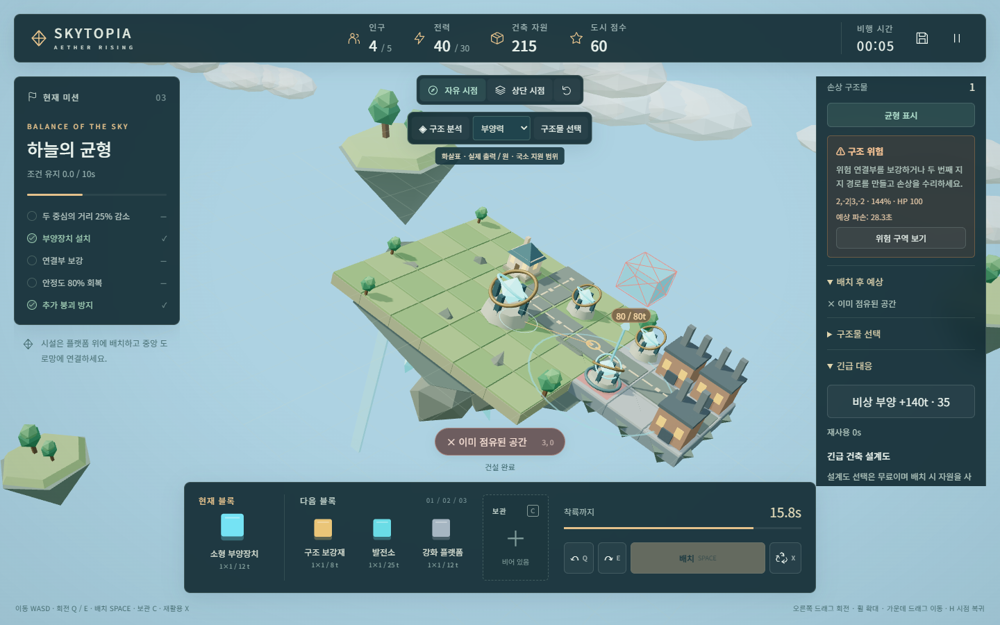

# SKYTOPIA: AETHER RISING

**PHASE 2 — GRAVITY AND COLLAPSE · 중력과 붕괴**

하늘 위 도시를 건설하고, 하중을 분석하고, 붕괴에서 구하세요. 브라우저에서 실행하는 싱글 플레이 3D 건설 퍼즐입니다. 건물의 질량·부양장치 위치·전력·연결부 손상이 실제 구조 계산과 도시 생존에 영향을 줍니다.



## 실행

Node.js **22.12 이상**과 WebGL을 지원하는 데스크톱 브라우저를 사용하세요.

```sh
npm ci
npm run dev
```

터미널에 표시된 주소를 엽니다. 기본 주소는 `http://127.0.0.1:5173`입니다. API 키나 서버 계정, 유료 에셋이 필요하지 않습니다. 모델·효과음은 코드로 생성하며 외부 CDN에서 받지 않습니다.

```sh
npm test              # 순수 게임 규칙 회귀
npm run typecheck     # strict TypeScript 검사
npm run build         # dist/ 정적 프로덕션 빌드
npm run preview       # 프로덕션 빌드 로컬 실행
npm run test:e2e       # 설치된 Chrome으로 통합 검증
npm run test:e2e:edge  # 설치된 Edge로 통합 검증
npm run format:check
```

Chrome이 없다면 `npx playwright install chrome`으로 설치합니다. E2E는 5175 포트의 격리된 테스트 서버를 사용합니다. 일반 개발 서버에서는 테스트 연결 객체가 노출되지 않습니다.

## 플레이

메뉴에서 기존 **새로운 게임 / 건축 훈련**, **캠페인 선택 01–04**, **구조 실험실 A–D**로 진입합니다. 실험실은 시간 정지 상태로 시작하며, 자원·낙하 시간 제한 없이 건물을 골라 실험할 수 있습니다.

| 조작               | 기능                                                      |
| ------------------ | --------------------------------------------------------- |
| WASD / 방향키      | 카메라 방향 기준 격자 이동                                |
| Q / E              | 90° 회전                                                  |
| Space / 왼쪽 클릭  | 보이는 예상 위치에 배치                                   |
| C                  | 보관·교환: 일반 공급 블록당 1회                           |
| X                  | 재활용; 긴급 설계도를 선택했다면 선택 취소                |
| 오른쪽 드래그      | 카메라 회전                                               |
| 휠 / 가운데 드래그 | 확대·축소 / 화면 이동                                     |
| H                  | 기본 시점 복귀                                            |
| Tab                | 캔버스에서 구조 분석 순환; UI 버튼에서는 일반 포커스 이동 |
| Esc                | 일시정지·재개                                             |

**구조물 선택**을 켜고 격자를 클릭하면 수리·보강·철거를 사용할 수 있습니다. 건물 아래 플랫폼은 선택 패널의 플랫폼 버튼으로, 연결부는 인접 연결부 버튼으로 선택합니다. 철거는 확인 창에서 인구·전력·부양력·안정도 변화를 보여줍니다. 코어와 지반은 철거 대상이 아닙니다.

배치 예상은 질량·부양력·전력·무게중심·안정도와 위험 플랫폼을 계산합니다. 노란색은 주의, 주황색은 과부하, 빨간색 경고는 치명적 위험입니다. 위험해도 공간·지지 조건이 맞으면 배치할 수 있습니다. `×`는 점유 충돌 등 배치 불가입니다.

## 구조와 복구 규칙

- 초기 6×6 섬을 최대 16×16까지 확장합니다. 기존 6종에 강화 플랫폼·대형 주거·공장·소형/대형 부양장치·보강재·균형추를 추가했습니다.
- 초기 지반 180t, 시설 41t, 섬 기반 질량 80t를 합쳐 초기 도시 질량은 **301t**입니다. 여러 칸짜리 시설의 질량과 능력치는 ID당 한 번만 계산합니다.
- 코어 부양력은 500t, 소형 장치는 80t, 대형은 220t입니다. 실제 출력은 전력·가동·내구성에 따릅니다. 정전 후 8초 동안 이전 출력을 유지한 뒤 점진적으로 감소합니다.
- 상하좌우 플랫폼 그래프의 모든 연결 경로로 하중을 나눕니다. 좁은 외팔보는 하중·거리 모멘트가 집중됩니다. 다른 경로를 추가하거나 가까이에 부양장치를 놓으면 부담이 줄어듭니다.
- 부양·균형·구조 안정도를 별도로 표시합니다. 종합 점수가 높아도 코어 손실·치명적인 부양 부족·과도한 기울기는 독립적으로 패배를 유발합니다.
- 과부하 피해는 0.25초 고정 간격으로 누적됩니다. 끊어진 구역에 충분한 자체 부양력이 없으면 붕괴합니다. 건물과 점유·질량·전력·인구를 먼저 제거한 뒤 최대 32개 잔해를 4초간 연출합니다.
- 수리는 자원을 소비하고 3초 뒤 최대 내구성의 65%를 회복합니다. 하중 원인은 그대로이므로 과부하를 먼저 줄여야 합니다.
- 플랫폼/연결부 보강은 최대 3단계입니다. 단계마다 8t와 내구성 100, 기본 허용 하중의 85%를 추가합니다.
- 비상 부양은 35자원으로 140t를 20초간 공급하며, 가동 시작부터 45초 재사용 제한이 있습니다. 비용은 난이도에 따라 달라집니다.
- 긴급 설계도로 안전 시설을 직접 구매할 수 있습니다. 선택 중 일반 낙하 타이머는 멈추지만 구조 시뮬레이션은 계속됩니다. 배치/취소 후 원래 블록·공급 대기열로 돌아옵니다.
- 새 캠페인 공급은 시드 기반 16개 Bag와 필요에 따른 최대 1개의 보조 블록을 사용합니다. 훈련·기존 저장의 클래식 Bag를 보존합니다. 캠페인 2–4에서는 인구당 초당 0.04자원의 대응 예산을 얻습니다.

## 캠페인과 실험실

| 모드               | 목표                                                                                                 |
| ------------------ | ---------------------------------------------------------------------------------------------------- |
| 01 최초의 빛       | 기존 7개 조건: 확장·주거·인구 25·추가 발전·도로·전력·안정도                                          |
| 02 발전의 무게     | 인구 50, 소형 부양, 질량 300t, 안정도 75%, 연결부 과부하 없이 20초 유지                              |
| 03 하늘의 균형     | 기울어진 산업 지구에서 두 중심 거리 25% 감소, 부양·연결부 보강, 안정도 80%, 추가 붕괴 없이 10초 유지 |
| 04 추락에 맞서다   | 손상 구조 수리, 연결부 2개 보강, 부양력 확보, 코어 보호, 60초 생존 후 조건 5초 유지                  |
| 실험 A / B / C / D | 무게중심 / 국소 부양 / 하중 경로 / 연쇄 붕괴, 시간 정지·재개·초기화                                  |

쉬움·일반·어려움은 새 게임에 적용됩니다. 경고음·효과음·음악 볼륨과 그림자·움직임 줄이기를 조절할 수 있습니다. 훈련은 치명적 위험 시 시간을 멈춰 대응을 돕습니다.

## 저장

캠페인/훈련은 `skytopia.save.v2`, 실험실은 `skytopia.lab.v2`, 설정은 `skytopia.settings.v1`에 저장합니다. 수동·10초 자동·종료 저장을 지원합니다. 두 게임 슬롯은 독립적이며 새 게임의 첫 저장부터 해당 슬롯을 교체합니다.

Phase 1 `skytopia.save.v1`이 있고 v2 슬롯이 없다면 기존 좌표·공급 RNG·보관·인구를 유지하며 새 구조 필드를 기본값으로 마이그레이션합니다. 손상된 v2를 오래된 v1으로 조용히 되돌리지 않습니다. 저장에는 내구성·보강·출력 유예·복구 작업·붕괴 대기열·사건·미션 유지 시간도 포함되며, 하중/중심/연결은 불러올 때 재계산합니다.

LocalStorage는 브라우저와 origin별로 분리됩니다. 저장소 삭제 시 진행이 사라집니다. 저장 실패는 안내하고 플레이는 계속합니다.

## 코드와 검증

- `src/game/stability/`: 질량·부양·전력망·구조 그래프·하중 해법·고정 시뮬레이션·붕괴.
- `src/game/repair/`: 수리·보강·비상 부양·철거·긴급 설계도.
- `src/game/engine.ts`, `placement.ts`, `supply.ts`, `storage.ts`: 기존 게임 루프와 통합.
- `src/data/rules.ts`, `missions.ts`: 수치와 시나리오 정의.
- `src/components/StructuralUI.tsx`: 분석·예측·복구·실험·패배 UI.
- `src/scene/`: 순수 규칙과 분리된 Three.js 렌더링, 인스턴싱, 균열·잔해·에너지 연출.

상세 계산·변경 목록·Phase 3 준비 상태는 [Phase 2 개발 보고](docs/PHASE2-REPORT.md), 테스트와 실측 성능은 [검증 보고](docs/VERIFICATION.md)를 확인하세요. [Phase 1 검증 기록](docs/VERIFICATION-PHASE1.md)과 양 단계 원본 명세도 보존했습니다.

CPU 측정은 `node node_modules/vite-node/vite-node.mjs scripts/measure.ts`로 재현합니다. 브라우저 성능 측정은 PowerShell에서 다음과 같이 실행합니다.

```powershell
$env:SKYTOPIA_MEASURE='1'
npx playwright test e2e/performance.spec.ts --project=chrome
Remove-Item Env:SKYTOPIA_MEASURE
```

성능 측정은 임계 FPS 통과를 선언하지 않고 실제 수치를 `test-results/`에 기록합니다. 일반 CI는 이 측정만 생략하고 플레이 테스트를 실행합니다.

## 배포와 제한

`dist/`를 정적 호스팅에 배포할 수 있습니다. 상대 경로 빌드로 하위 경로를 지원합니다. 현재는 도메인/환경변수가 필요하지 않습니다. 향후 절대 URL·인증·API 도입 시 `APP_DOMAIN`/`APP_ORIGIN`을 중앙 설정에서 읽고 `.env.example`과 배포 문서를 함께 갱신해야 합니다. 애플리케이션 소스에 개발 도메인을 넣지 않았습니다.

단일 높이의 게임용 구조 근사 모델이며 실제 공학 설계용 해석기는 아닙니다. 잔해는 충돌 물리 대신 결정론적 낙하 연출을 사용합니다. 다층 도시·경제·식량 유통·교역·멀티플레이는 후속 범위입니다. PC 마우스/키보드, 1024×768 이상을 기준으로 합니다. Firefox/Safari·모바일·장시간 메모리 안정성·실제 저사양 GPU 성능은 검증하지 않았습니다. Three.js 청크의 500kB 권고 경고가 남아 있습니다. DNS·인증서·공개 웹 배포는 변경하지 않았습니다.
