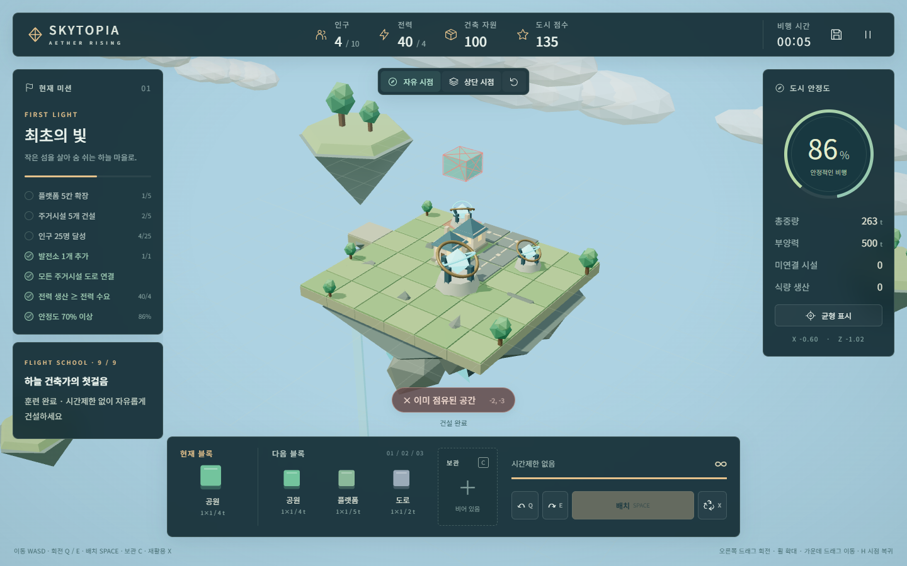

# SKYTOPIA: AETHER RISING

**하늘 위에 건설하라. 균형을 유지하라. 새로운 문명을 일으켜라.**

브라우저에서 실행하는 싱글 플레이 3D 건설 퍼즐 게임입니다. 공중에서 내려오는 블록을 배치하면 영구적인 도시의 일부가 됩니다. 도로와 발전소를 연결하고, 플랫폼을 확장하며, 도시의 무게중심을 관리하세요.



## 실행

Node.js **22.12 이상**을 사용하세요. 개발·검증에는 Node.js 24를 사용했습니다.

```sh
npm ci
npm run dev
```

터미널에 표시된 로컬 주소를 엽니다. 기본 주소는 `http://127.0.0.1:5173`입니다. 하드웨어 가속과 WebGL을 지원하는 데스크톱 브라우저가 필요합니다. API 키, 서버 계정, 유료 에셋은 필요하지 않습니다. 글꼴과 모델을 외부 CDN에서 받아오지 않습니다.

```sh
npm run typecheck   # TypeScript 검사
npm test            # 게임 로직 테스트
npm run build       # 타입 검사 + dist/ 프로덕션 빌드
npm run preview     # 빌드 결과 로컬 확인
npm run test:e2e    # 설치된 Chrome으로 브라우저 통합 테스트
npm run test:e2e:edge # 설치된 Edge로 같은 흐름 확인
```

Chrome이 없다면
px playwright install chrome`으로 설치할 수 있습니다. E2E 테스트는 5175 포트의 개발 서버를 사용하며, 실행 중인 서버가 없으면 자동으로 시작합니다. 테스트용으로 소프트웨어 WebGL을 사용하므로 실제 GPU 성능 측정 결과와는 다릅니다.

## Phase 1 구현 기능

- 로우폴리 부유섬, 바위·초목·폭포·구름·원거리 섬, 회전하는 에테르 코어.
- 6×6 초기 플랫폼, 주거시설 1개, 발전소 1개, 중앙 도로. 16×16까지 인접 플랫폼 확장.
- 플랫폼·주거·발전·도로·농장·공원의 6개 종류와 단일/I/L/T/O/S 점유 형태.
- 시드 기반 9개 Bag 공급, 다음 블록 3개, 보관 1개, 20초 낙하, 유효 위치 자동 배치와 잘못된 위치 재활용.
- 좌우 회전·이동·마우스 배치, 도로/안정도 경고, 반투명 낙하 블록과 배치 예상 표시.
- 중앙 도로에서 BFS로 연결 탐색. 연결된 발전소의 전력 공급, 연결·전력이 확보된 주거 수용량까지 점진적인 인구 증가.
- 인구·수용량·전력·자원·점수·식량 생산·시설 수·질량·부양력·무게중심·안정도 통계.
- 질량을 반영한 도시의 미세한 기울기, 무게중심/부양 중심 표시, 위험 경고. 기울어진 섬에서도 로컬 좌표로 격자를 선택합니다.
- First Light 미션의 7개 조건 동시 판정, 승리 결과 화면, 승리 후 자유 건설.
- 9단계 행동 기반 훈련, 순서가 정해진 훈련 블록, 시간제한 해제, 훈련 건너뛰기.
- 한국어/영어, 사운드·그림자·움직임 줄이기 설정, 일시정지·자동 탭 비활성 정지.
- 버전 1 LocalStorage 저장, 10초 자동 저장·수동 저장·종료 저장, 이어하기. 저장 실패/손상 데이터 복구 안내.
- 배치 에너지 파동·입자·합성 효과음. 외부 물리 엔진 없이 렌더링과 순수 게임 규칙 분리.

## 조작

| 조작               | 기능                              |
| ------------------ | --------------------------------- |
| WASD / 방향키      | 카메라 방향 기준 블록 이동        |
| Q / E              | 반시계 / 시계 방향 90° 회전       |
| Space / 왼쪽 클릭  | 배치                              |
| 마우스 이동        | 커서 아래 격자 선택               |
| C                  | 보관·교환 (블록당 1회)            |
| X                  | 재활용: 자원 +2, 점수 −5 (최소 0) |
| 오른쪽 드래그      | 360° 카메라 회전                  |
| 휠 / 가운데 드래그 | 확대·축소 / 화면 이동             |
| H                  | 기본 시점 복귀                    |
| Esc                | 일시정지·재개                     |

상단 시점·자유 시점, 회전·배치·보관·재활용, 저장 버튼도 제공합니다. 시설을 클릭하면 선택한 블록을 배치하려고 시도하므로 기존 시설과 겹치면 거부됩니다. 빈 플랫폼 없는 위치에는 건물을 지을 수 없으며, 에테르 코어 `(0,0)`는 보호됩니다.

초록색 `✓`는 배치 가능, 노란색 `△`는 도로 연결/균형 경고, 빨간색 `×`는 배치 불가입니다. 노란색 상태의 건물은 배치할 수 있으며 도로를 이어 운영을 시작할 수 있습니다. 전력 부족과 미연결 시설에는 상단 표시가 나타납니다.

## 기본 규칙과 첫 미션

중앙 도로 `(0,-1)`에서 상하좌우로 이어진 도로에 시설이 인접하면 연결됩니다. 발전소는 연결되었을 때만 전력을 공급합니다. 전력 생산이 도시 전체 수요 이상이면 연결된 주거시설의 수용량까지 초당 0.5명씩 인구가 증가합니다. 부족해지면 성장이 멈추며 기존 인구는 유지됩니다.

블록 하나가 여러 칸을 차지해도 해당 시설의 능력치와 무게는 **한 번**만 계산합니다. 질량은 점유 칸 전체에 균등 분포합니다. 초기 지반 36칸은 각각 5t, 새 플랫폼 블록은 전체 5t입니다. 초기 부양력은 500t입니다. 균형과 부양 여유가 줄면 경고하지만 Phase 1에서는 붕괴하지 않습니다.

첫 미션의 동시 달성 조건:

1. 플랫폼 5칸 이상 확장
2. 주거시설 5개 이상 (초기 1개 포함)
3. 인구 25명 이상
4. 발전소 1개 이상 추가
5. 모든 주거시설 중앙 도로 연결
6. 전력 생산 ≥ 수요
7. 안정도 ≥ 70%

플랫폼·도로가 나오지 않을 때는 보관과 재활용을 활용하세요. 매 9개 Bag에는 플랫폼 2개, 도로 2개, 주거 2개, 발전소·농장·공원 각 1개가 포함됩니다. 보관은 남은 낙하 시간을 늘리지 않습니다. 자원은 Phase 1에서 기록/재활용 보상용이며 건축 비용으로 소비하지 않습니다. 농장은 식량 생산 통계, 공원은 점수에 반영합니다.

훈련에서는 안내 순서가 끝날 때까지 보관/재활용을 잠그고, 현재 단계의 조작을 먼저 수행하도록 안내합니다. 훈련을 건너뛰면 자유롭게 사용할 수 있습니다.

## 프로젝트 구조

```text
src/
  components/       메뉴, HUD, 대화상자, 입력·시간·사운드 수명주기
  data/rules.ts     블록 능력치, 형태, 건설 범위, 게임 설정
  game/
    grid.ts         좌표·형태 회전·카메라 기준 이동
    supply.ts       시드 PRNG와 Bag 공급
    placement.ts    충돌·지원 플랫폼·인접성·보호 구역 판정
    engine.ts       순수 상태 전이: 생성·배치·시간·보관·재활용
    analysis.ts     도로 BFS, 자원/전력/인구 수용량, 안정도, 미션
    storage.ts      버전별 스키마와 구조 무결성 검사, 저장/복구
  scene/            3D 카메라·환경·섬·시설·낙하·배치 효과
  stores/           Zustand 게임 상태와 UI 상태
  types/            엔진/렌더러 공용 타입
  locales/          한국어·영어 UI 및 튜토리얼 문구
  tests/            순수 게임 로직 회귀 테스트
e2e/                Chrome 브라우저 통합 테스트
docs/               원본 명세, 검증 보고, 캡처
```

기술: TypeScript 5.9, React 19, Vite 7, Three.js 0.181, React Three Fiber 9, Drei 10, Zustand 5, Zod 3, Vitest 3, Playwright. 정확한 설치 버전은 `package-lock.json`을 기준으로 합니다. React와 Fiber 메이저 버전은 [공식 호환 지침](https://r3f.docs.pmnd.rs/getting-started/installation)에 맞췄습니다.

## 저장과 배포

진행은 `skytopia.save.v1`, 설정은 `skytopia.settings.v1`에 저장합니다. 슬롯은 하나이며 브라우저/사이트 origin별로 분리됩니다. 새로운 게임을 시작하면 다음 저장 시 이전 슬롯을 교체합니다. 저장에는 배치·회전·공급 RNG/Bag·보관·시간·자원·미션·설정이 포함됩니다. 연결망과 점유표는 검증한 배치 데이터에서 다시 계산하여 이중 상태 불일치를 피합니다.

손상 데이터는 무시하고 새 게임 진입을 허용합니다. 저장 공간을 사용할 수 없으면 오류 메시지를 표시하고 게임은 계속 실행합니다. LocalStorage를 지우면 진행도 삭제되며 클라우드 동기화는 없습니다.

`dist/`를 정적 호스팅에 배포할 수 있습니다. 상대 경로 빌드이므로 하위 경로 호스팅도 가능합니다. 현재 기능에는 도메인이나 비밀 환경변수가 필요하지 않습니다. 이후 인증·API·절대 URL을 추가할 때는 `APP_DOMAIN`/`APP_ORIGIN`을 중앙 설정에서 읽고 `.env.example`과 배포 안내를 함께 갱신해야 합니다. 애플리케이션 소스에 개발 도메인을 하드코딩하지 않습니다. DNS/인증서/프로덕션 라우팅은 이 구현에서 변경하지 않았습니다.

## 검증과 현재 제한

검증 결과와 수행 범위는 [검증 보고](docs/VERIFICATION.md)에 기록합니다. GitHub Actions는 타입/빌드·단위·Chrome 통합 테스트를 실행하도록 구성했습니다.

- 단일 높이 층만 지원합니다. 실제 붕괴·부재별 하중 전파·수직 도시·전력선·식량 소비·행복도·경제는 후속 단계입니다.
- 마우스/키보드 중심 PC 게임입니다. 모바일은 이번 범위에 포함하지 않습니다.
- 초기 UI는 1024×768 이상에서 검증합니다. WebGL 미지원 시 하드웨어 가속 안내를 표시합니다.
- Three.js 런타임 청크가 500kB를 초과해 Vite의 크기 권고 경고가 발생합니다. 3D 장면은 지연 로드하며 DPR은 1.6으로 제한합니다.
- 장시간 플레이·최대 256칸 도시의 실제 GPU/메모리 성능과 Firefox/Safari 호환성은 별도 확인이 필요합니다.

## Phase 2 확장 지점

순수 `game/` 모듈은 Three.js/React에 의존하지 않습니다. `Building.y`, `Platform.y`와 `durability` 필드가 준비되어 있고, 점유·도로망·안정도는 각각의 함수로 분리했습니다. Phase 2에서 별도의 구조 그래프/하중 분석기를 추가하고 물리 엔진 이벤트를 상태 전이로 전달할 수 있습니다. 현재 단일 층·단일 부양 중심을 사용하는 스키마는 다층/다중 부양장치 도입 시 새 버전과 명시적 마이그레이션이 필요합니다.
