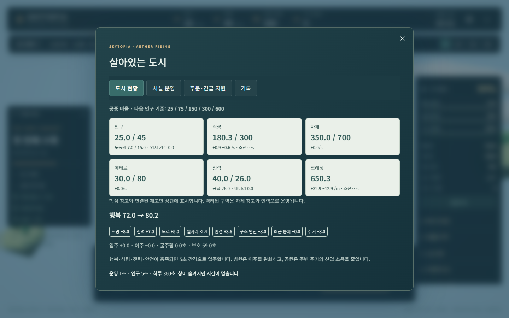
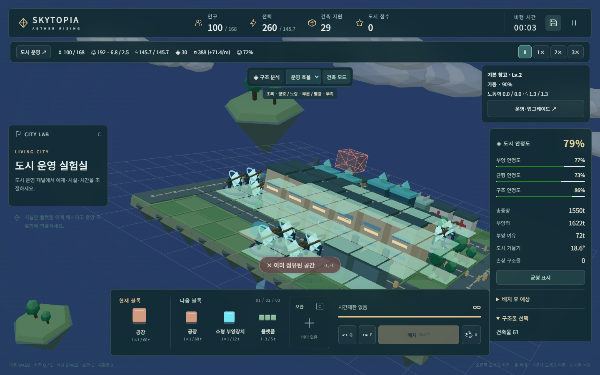
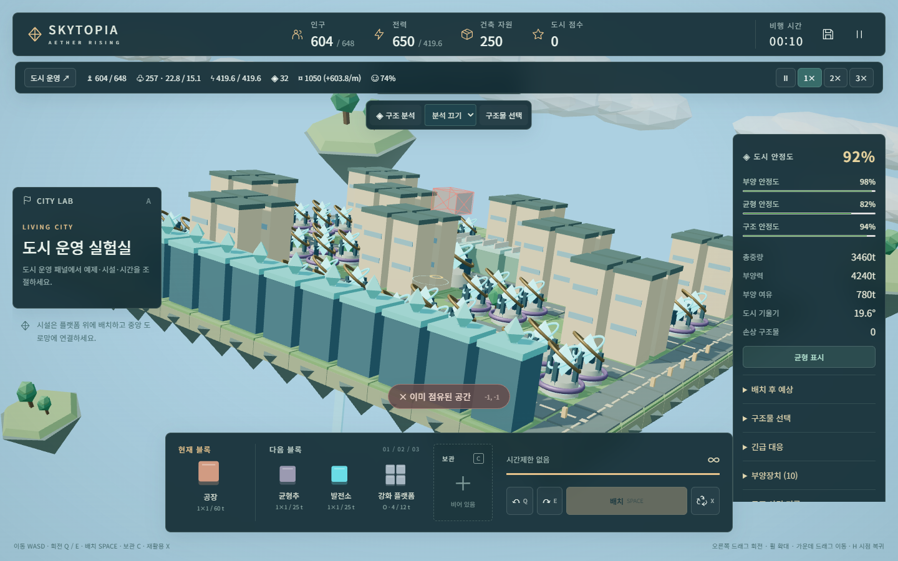

# Phase 3 검증 보고

검증일: 2026-11-26 (Asia/Seoul). Windows, Node.js 24.14.0, AMD Ryzen AI 9 365. Chrome 158.0.8127.37 / Edge 158.0.4370.33.

## 검증 범위와 결과

DOM 입력 → Zustand → 순수 게임 엔진/구조·도시 운영 → Three.js 장면/HUD → LocalStorage → 스키마 검증/재구성을 확인했습니다. 서버/API는 없습니다. [Phase 1](VERIFICATION-PHASE1.md)과 [Phase 2](VERIFICATION-PHASE2.md) 검증 기록은 보존했습니다.

| 항목                     | 결과                  | 범위                                                                     |
| ------------------------ | --------------------- | ------------------------------------------------------------------------ |
| Vitest                   | 103개 통과            | 기존 75개 + 도시 시스템 20개 + 시작 상태 2개 + 미션 5개 + 600명 도시 1개 |
| TypeScript strict / Vite | 통과                  | 프로덕션 빌드, Three.js 청크 크기 권고 경고만 남음                       |
| Chrome / Edge            | 각 10개, 총 20개 통과 | 기존 플레이 8개 + 도시 운영 2개씩                                        |
| 도시 최종 재검증         | 두 브라우저 각 2개    | 최종 숫자 표시 수정 후 운영/저장/미션 진입                               |
| 대도시 WebGL 실측        | 별도 1개 통과         | 활성 도시 → 600명 도시 → 초기화, 치명적 위험 없음 확인                   |
| 형식 / diff              | 통과                  | Prettier 및 git diff --check                                             |

일반 브라우저 실행에서는 두 수동 성능 측정이 브라우저별로 생략되어 총 4개 skip입니다. 도시 성능 측정은 SKYTOPIA_CITY_MEASURE=1로 별도 실행했습니다. 최종 전체 단위 테스트와 빌드를 재실행하고 결과를 확인했습니다. 프로덕션 번들에 **SKYTOPIA_TEST** / **SKYTOPIA_PERF** 연결이 없음을 확인했습니다.

Phase 2의 과거 보고는 단위 테스트를 74개로 기재했으나 실제 기반 테스트는 엔진 45개, 구조 28개, 저장 2개의 75개입니다. 이 보고는 실제 실행 개수를 사용합니다.

## 명세 A–L

| 시나리오     | 확인한 동작                                                                                 |
| ------------ | ------------------------------------------------------------------------------------------- |
| A 정상 성장  | 점진적 입주, 인구 기반 노동력, 실제 생산/소비, 도시 등급과 일회성 보상                      |
| B 식량 부족  | 비축 감소, 소진 예상, 기아 유예 후 행복/인구 감소, 보호 기간의 급격한 이탈 방지             |
| C 전력 단절  | 독립 전력 컴포넌트, 전력 연결재와 물류 도로 구분, 부양 우선 공급, 유한 배터리, 재가동 회복  |
| D 인력 부족  | 생산 효율 감소, 우선순위 변경에 따른 실제 인력 재배정, 인력 총량 보존                       |
| E 산업 성장  | 연결 공장의 실제 자재 생산과 유지비, 시설 질량·수요·하중 반영                               |
| F 경제 위기  | 적자/소진 보고, 정지 비용 변화, 유한 구호·판매·긴급 구매와 재사용 제한                      |
| G 붕괴       | 실제 구조 스텝으로 발전소/창고 제거, 즉시 생산/재고 손실, 주거 대피와 남은 도시 유지        |
| H 업그레이드 | 물리 재고/크레딧 차감, 점유 보존, 질량·수요·정원·구조 재계산, 브라우저 업그레이드           |
| I 낮/밤      | 게임 시간 동기화, 주기/야간 조명, 브라우저 야간 전환과 캡처                                 |
| J 정지/배속  | 고정 스텝 분할 독립성, 0/1/2/3배속, 경제·이주·주문·낙하·구조 정지, 패배 시 잔여 시간 제거   |
| K 저장       | v3 왕복, v2/v1 마이그레이션, 인구/재고 회계 오류 거부, 브라우저 저장/새로고침/정확한 복원   |
| L 기존 회귀  | 메뉴·훈련·카메라·회전·공급·배치·플랫폼·보관·안정도·붕괴·수리·비상 부양·구조 실험실·미션 1–4 |

추가 검증: 저장 상한에서 같은 틱의 식량 소비를 포함한 실제 생산량, 고립 창고 접근 제한, 무제한 실험 전환, 지연 주문의 공급 큐 합류, 대표 경로의 실제 도로/연결부 준수, 난이도별 노동/소비/구호, 비상 부양의 에테르 실제 차감.

미션 5–9는 일반 난이도로 실제 배치 검증·비용·공급 전진을 거쳐 각각 140초 진행해 승리를 확인합니다. 알려진 공급 블록/손상 상태를 주입해 재현성을 확보하므로 모든 무작위 시드의 완주 보증은 아닙니다. 브라우저에서는 실제 버튼·키보드·마우스를 사용하고 일부 상태/시간을 테스트 전용 연결로 지정합니다. 사람이 임의의 캠페인을 처음부터 끝까지 완주한 결과와 구분합니다.

## 수정한 검증 실패

- 주문 후 버튼이 비활성화되어 포커스가 문서로 이동하면 Escape가 관리 창 대신 게임을 멈췄습니다. 최상위 대화상자만 문서 캡처 단계에서 Escape/Tab을 처리하도록 수정했습니다.
- 도시 예제를 바꾸며 다수 Drei HTML 경고를 동시에 제거할 때 React DOM removeChild 오류가 발생했습니다. 도시 모드는 최대 256개의 인스턴스 상태 표시를 사용하고 기존 구조 모드 표시는 유지했습니다. 이후 두 브라우저의 전체 흐름과 페이지 오류 0건을 확인했습니다.
- 3배속 중 패배 시 고정 시간 잔여량이 저장 스키마 범위를 벗어날 수 있어 패배 시 누적 시간을 비웁니다.
- 비상 부양이 에테르 보유 여부만 확인하던 경로를 실제 2에테르 차감으로 수정했습니다.
- 대도시 검증의 짧은 생존 시간이 기울기 보호 유예에 의존하던 점을 발견했습니다. 구조 규칙은 유지하고 배치를 균형 있게 조정했으며 치명적 위험 없음과 70초 무붕괴 검증을 추가했습니다.

## 시각 확인

1440×900에서 운영 개요, 시설 목록/업그레이드, 야간 도시, 활성 대도시를 캡처하여 확인했습니다. 숫자는 필요한 소수 자리로 제한하고 HUD·조언·구조 패널·모달의 가림을 확인했습니다. 기존 1024×768 구조 HUD 회귀도 브라우저 검증 범위입니다.

## CPU 실측

256플랫폼 / 135시설 / 600명 / 정원 648. 발전 650, 수요 419.6, 식량 생산 22.8125/초, 소비 15/초. 안정도 91.629, 치명적 위험 없음, 저장 54,844바이트. 70초 동안 붕괴/패배 없이 600명 이상 유지하며 등급 6 달성을 검증했습니다. 고정된 수동 구성 배치이며 무작위 캠페인으로 이 배치에 도달했다는 의미는 아닙니다.

Node/Vite-node에서 렌더링과 분리해 작업당 10회 워밍업 후 측정했습니다. 고정 스냅샷에서 한 작업의 비용이며 장시간 전체 플레이 평균은 아닙니다.

| 작업              | 표본 |    중앙값 |       P95 |
| ----------------- | ---: | --------: | --------: |
| 경제 1초          |  100 |  8.862 ms | 14.306 ms |
| 인구 5초 업데이트 |  100 |  8.511 ms | 13.952 ms |
| 구조 0.25초       |  100 |  8.494 ms | 15.959 ms |
| 통합 0.25초       |  100 | 17.297 ms | 27.788 ms |
| 캐시된 도시 보고  | 5000 | 0.0009 ms | 0.0012 ms |
| 저장 검증/재구성  |  100 |  4.525 ms |  7.788 ms |

[원본 JSON](performance-city.json). 재현: node node_modules/vite-node/vite-node.mjs scripts/measure-city.ts.

네트워크·보고·대표 경로는 원본 참조로 캐시하며 관련 상태가 바뀌면 재계산합니다. 생산 1Hz / 인구·행복 0.2Hz / 구조 4Hz입니다. 변경된 컴포넌트만 다시 푸는 증분 솔버와 거리 기반 애니메이션 LOD는 구현하지 않았습니다.

## WebGL 실측

Chrome **SwiftShader 소프트웨어 WebGL**, 1440×900, DPR 1, 그림자 켬, 개발 빌드. 경제와 대표 이동이 1배속으로 실행 중인 장면입니다. 각 단계 2초 워밍업 후 8초 집계했습니다. gl.info는 이전 렌더 프레임의 실제 카운터입니다.

| 장면                | Calls | 삼각형 | Geometry | 표본 | 평균 FPS | 프레임 중앙값 / P95 |
| ------------------- | ----: | -----: | -------: | ---: | -------: | ------------------- |
| 121플랫폼 / 70시설  |   274 | 25,640 |      288 |   40 |     4.37 | 169.8 / 515.0 ms    |
| 256플랫폼 / 135시설 |   519 | 64,380 |      533 |   27 |     3.09 | 248.3 / 780.7 ms    |
| 초기화 후           |   273 | 25,560 |      288 |   38 |     4.45 | 173.3 / 506.3 ms    |

[원본 JSON](performance-city-browser.json). 모든 단계에서 패배와 치명적 구조 위험이 없었습니다. 대도시 측정 종료 인구는 약 604.6명입니다. Geometry는 288로 복귀했고 texture는 전 과정 2개였습니다. 단일 확장/초기화의 자원 반환 확인이며 장기간 메모리 누수 부재를 입증하지 않습니다.

소프트웨어 렌더링은 느리고 표본이 작습니다. 이 결과를 실제 GPU의 FPS로 해석하거나 60 FPS를 달성했다고 주장하지 않습니다. 실제 GPU·저사양 장치의 별도 측정이 필요합니다.

## 제한

집계 인구와 최대 48명 대표 시민/16대 차량을 사용합니다. 물류는 연결된 구역 안에서 즉시 재고를 공유하며 교통 체증/적재 운송 회계가 없습니다. 시설 모델은 코드로 만든 저폴리 모듈, 음악은 합성 화음입니다. 개별 시설별 모든 장식 동작·가로등·거리별 LOD를 완성했다고 주장하지 않습니다. 구조는 기존 게임 근사이며 정밀 공학 해석이 아닙니다.

Firefox/Safari, 모바일, 실제 GPU, 장시간 반복 세션은 미검증입니다. Three.js 번들 크기 경고가 남습니다. 공개 웹 배포·DNS·인증서는 변경하지 않았습니다. 구현 상세와 23개 항목의 개발 보고는 [PHASE3-REPORT.md](PHASE3-REPORT.md)에 있습니다.
