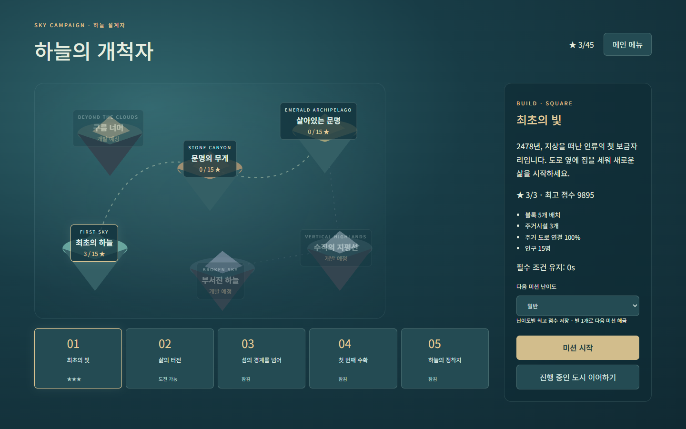
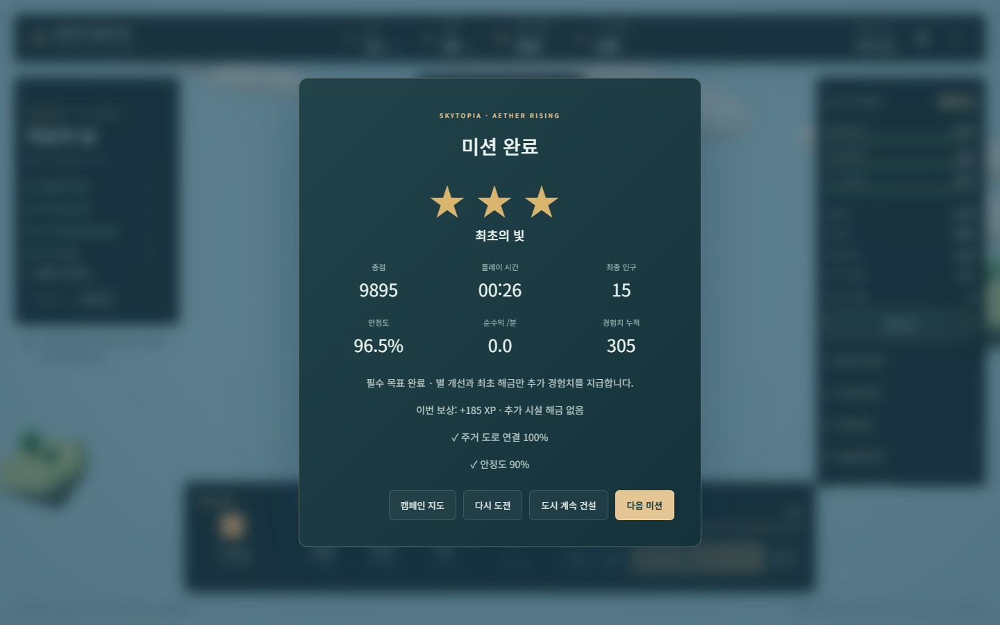
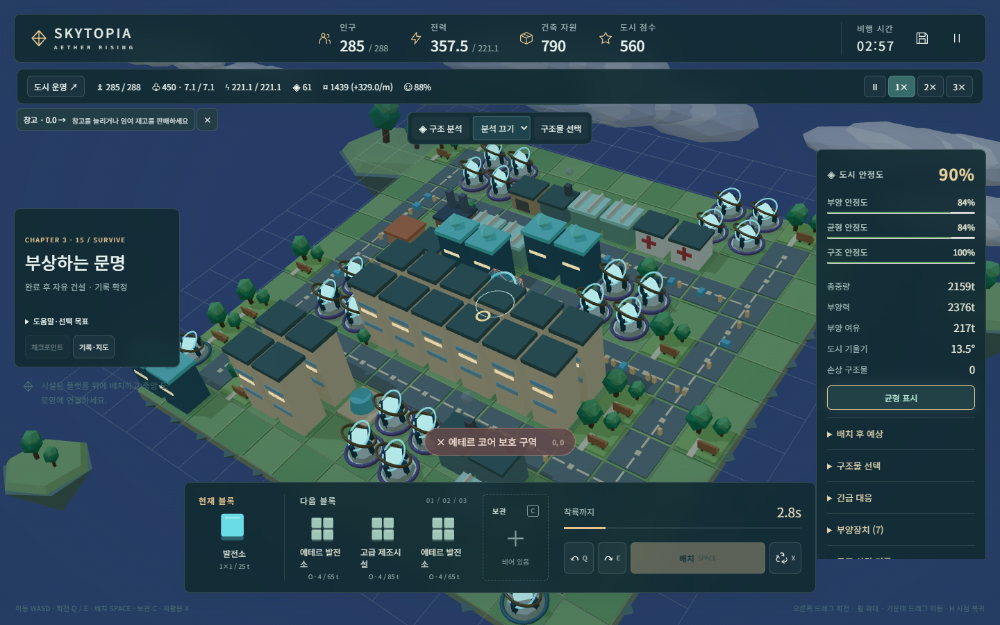

# Phase 4 검증 보고

검증일: 2026-11-26 (Asia/Seoul). Windows, Node.js 24.14.0, AMD Ryzen AI 9 365. [Phase 3 검증](VERIFICATION-PHASE3.md)을 별도 보존했습니다.

## 검증 범위와 결과

브라우저 입력 → Zustand → 캠페인/기존 게임 엔진 → 도시·구조 보고와 HUD → 원자적 LocalStorage 저장 → 스키마 검증·복원을 확인했습니다. 백엔드/API는 없습니다.

| 항목                     | 결과       | 범위                                                           |
| ------------------------ | ---------- | -------------------------------------------------------------- |
| Vitest 전체              | 137개 통과 | 기존 103 + 캠페인 데이터 3 + 진행/저장 13 + 본편·도전 승리 18  |
| 최종 연구 해금 재검증    | 31개 통과  | 진행/저장 13 + 실제 미션 승리 18                               |
| TypeScript strict / Vite | 통과       | 캠페인 UI 지연 청크 17.14kB, main 245.49kB, Three.js 크기 경고 |
| Chrome·Edge 전체 회귀    | 24개 통과  | 기존 10 + 새 캠페인 2, 브라우저마다 12개                       |
| 최종 캠페인 브라우저     | 8개 통과   | 기본 2 + 자유 저장 분리 + 손상 저장 보호, 브라우저마다 4개     |
| 형식 / diff              | 통과       | Prettier 및 git diff --check                                   |

브라우저 고유 흐름은 현재 브라우저당 14개(두 브라우저 28개)입니다. 24개 전체 실행 후 저장 경계 수정에 해당하는 8개를 다시 실행했습니다. 일반 실행의 수동 성능 측정 3개는 브라우저마다 생략합니다. 마지막 연구 선택 변경은 순수 엔진 테스트로 검증했고 해당 기능의 실제 버튼 조작은 별도 브라우저 검증 범위가 아닙니다. 프로덕션 dist에 **SKYTOPIA_TEST** / **SKYTOPIA_PERF**가 없음을 검색했습니다.

## 명세 A–J

| 시나리오      | 확인한 동작                                                                  | 검증 방식과 경계                                                   |
| ------------- | ---------------------------------------------------------------------------- | ------------------------------------------------------------------ |
| A 신규 캠페인 | 이름·새 프로필·오프닝 skip·브리핑·5블록·완료                                 | Chrome/Edge 실제 버튼·Space, 커서와 시간은 테스트 연결             |
| B 미션 해금   | 별·다음 잠금 해제·XP·프로필 저장                                             | 단위 + 브라우저 1→2                                                |
| C 다시 도전   | 독립 초기 도시·최고/최근 기록·보상 중복 차단·추가 별                         | 단위                                                               |
| D 미션 유형   | 15 본편·3 고정 도전의 실제 엔진 승리                                         | 허용 블록 주입 해법; 모든 난수 시드 보증 아님                      |
| E 대화        | 시간 정지·다음·skip·저장 왕복·중복 이벤트 차단                               | 단위 + 브라우저; 모든 대사별 자동 재생은 미검증                    |
| F 기술        | 잠긴 시설 배치/주문/설계도·초기 유지보수/업그레이드 차단·연구 선택 허용      | 단위, 기존 실험실 회귀                                             |
| G 저장        | 도시·진행·대화·보상·손상 복구·구버전 승리 이관                               | 단위 + 새로고침/이어하기 + 손상 원문 보존 브라우저                 |
| H 체크포인트  | 도시·시드·공급·자원·대화·유지 시간 스냅샷·전문가 감점                        | 단위 왕복 + 브라우저 수동 복원; 브라우저에서 붕괴 후 복원은 미검증 |
| I 승리/패배   | 필수 완료·시간 초과·보호 대상 소실·코어 손실·블록 소진·우선 판정·한 번 확정  | 단위 + 결과 화면 브라우저                                          |
| J 기존 회귀   | 건설·회전·카메라·하중·붕괴·도시 자원/인구/행복/경제·업그레이드·실험실·구저장 | 기존 103개 단위와 20개 브라우저 흐름; 자유 저장 새 검증            |

목표 조건은 표시용 숫자와 별도 모형이 아니라 기존 analyze/cityReport 및 실제 도시에서 계산합니다. 선택형 이벤트는 인구/재고를 실제 변경하고 중복 실행을 막습니다. 3배속 승리/시간 초과 뒤에도 저장 스키마를 통과하는지 확인합니다.

## 실행 가능한 해법의 의미

15 본편 + 101/102/103 도전은 실제 validatePlacement/place, 건설비 차감, 큐 전진, 수리/보강, tick을 사용합니다. 제한 퍼즐은 정확한 고정 공급을 따릅니다. 다른 해법은 허용 블록을 지정하고 일부 시설의 최적 위치를 검색합니다. 준비 배치 후 시뮬레이션을 진행하므로 사람의 전체 플레이 시간/체감 난이도/모든 공급 시드의 성공률은 아닙니다.

최종 미션 해법은 164.75초에 인구 약 278, 안정도 89.57, 필수 조건 7개를 모두 만족하고 60초 유지하여 승리했습니다. 구조 붕괴/패배가 없고 저장 왕복도 통과했습니다. 미션별 결과·별·남은 균형 문제는 [23개 항목 보고](PHASE4-REPORT.md)에 있습니다.

## 수정한 검증 실패와 점검 결과

- 미션 4 십자형 도시의 전력망 단절을 팔 부지 추가로, 미션 5 건축 공간 부족을 측면 부지로 수정했습니다.
- 미션 15 외곽 시설이 붕괴한 해법은 실제 보강/추가 부양을 포함해 고쳤고 승리 안정도 기준은 유지했습니다.
- 제한 퍼즐에서 보관/주문으로 6블록 공급을 우회하지 못하게 막았습니다.
- 모든 망의 발전 합계가 충분해도 특정 망이 부족하면 전력 자급 목표를 실패로 판정합니다.
- 메뉴 화면 간 이동이 이전 저장 슬롯을 새로 쓰던 경로와 3배속 종료 시 누적 시간 범위 문제를 수정했습니다.
- 자유 건설 이후 레거시 이어하기의 모드 상태를 초기화합니다. 손상 프로필은 자유 저장과 오프닝 재생 중에도 원문을 보존합니다.
- 자유 건설 브라우저 테스트의 잘못된 메뉴 버튼 이름을 실제 ‘저장 후 메뉴’로 수정한 뒤 양쪽 브라우저에서 통과했습니다.
- 연구 선택이 이미 허용된 시설을 다시 해금하던 중복을 제거했습니다. 미션 11은 선택 전 에테르 발전소 주문을 거부하고 선택 후 허용합니다.

## 시각 확인

1440×900 지도와 별 결과를 캡처하여 읽기, 잠금/개발 예정 표시, 버튼, 결과 보상 표시를 확인했습니다. 지도 진입 시 Canvas가 제거됩니다. 기존 1024×768 구조 HUD 검증은 회귀 범위에 포함됩니다. 새 지도/프로필의 모든 작은 해상도는 별도 검증하지 않았습니다.

## CPU 실측

최종 미션 시작 도시: 169플랫폼, 76시설, 인구 200. 프로필·현재 도시·동일 체크포인트를 담은 봉투는 74,410바이트입니다. 각각 5회 워밍업 뒤 독립적인 같은 스냅샷에서 측정했으며 실제 전체 플레이 평균이 아닙니다.

| 작업                                      | 표본 |     중앙값 |        P95 |
| ----------------------------------------- | ---: | ---------: | ---------: |
| load stage 1                              |   50 |   0.492 ms |   0.853 ms |
| load stage 15                             |   20 | 535.030 ms | 636.690 ms |
| campaign goals                            |  500 |   0.070 ms |   0.166 ms |
| quarter-second engine                     |   50 |  10.808 ms |  16.908 ms |
| profile update                            |   50 |   0.074 ms |   0.250 ms |
| validated campaign plus checkpoint decode |   50 |   7.074 ms |  10.347 ms |

[CPU 원본 JSON](performance-campaign.json). 재현: node node_modules/vite-node/vite-node.mjs scripts/measure-campaign.ts.

최종 도시 초기 배치는 유효 부지를 검색하므로 로딩 중앙값 약 0.535초입니다. 사전 계산된 배치 자산이나 비동기 생성으로 추가 최적화할 수 있습니다. 0.25초 통합 처리 중앙값은 약 10.8ms입니다. 목표/프로필 조회는 기존 파생 보고 캐시를 사용합니다.

## WebGL 실측

Chrome 158.0.8127.37, SwiftShader 소프트웨어 WebGL, 1440×900, DPR 1, 그림자 켬, 개발 빌드. 3회 첫 미션 입장마다 2초 준비 후 4초 측정하고 지도 복귀 시 Canvas 0개와 시간 정지를 확인했습니다. 최종 완료 도시는 2초 준비 후 8초 측정했습니다. 실제 카운터는 직전 렌더 프레임의 gl.info입니다.

| 장면              | Calls | 삼각형 | Geometry | 표본 | 평균 FPS | 프레임 중앙값 / P95 |
| ----------------- | ----: | -----: | -------: | ---: | -------: | ------------------: |
| 첫 미션 입장 1    |   119 |   5860 |      129 |   22 |     4.91 |    139.2 / 494.9 ms |
| 첫 미션 입장 2    |   119 |   5860 |      131 |   26 |     6.48 |    128.9 / 339.0 ms |
| 첫 미션 입장 3    |   119 |   5860 |      129 |   27 |     6.72 |    130.3 / 308.2 ms |
| 완료 후 최종 도시 |   375 |  40528 |      385 |   26 |     2.83 |    270.0 / 811.9 ms |

전체 측정은 1개 브라우저 테스트로 통과했습니다. 모든 단계에서 texture 2개, 첫 미션 geometry 129→131→129였으며 단조 증가하지 않았습니다. 최종 도시는 169플랫폼·87시설, 측정 종료 인구 285.63명이고 패배가 없었습니다. 자원을 제거한 뒤 재입장하는 짧은 실험으로, 장기 메모리 누수 부재를 증명하지 않습니다.

소프트웨어 렌더러에서 최종 도시 평균 2.83 FPS는 낮습니다. 이 결과를 실제 GPU 성능으로 해석하거나 목표 60 FPS를 달성했다고 주장하지 않습니다. 실제 GPU에서의 추가 계측과 최적화가 필요합니다.

[WebGL 원본 JSON](performance-campaign-browser.json). 재현: SKYTOPIA_CAMPAIGN_MEASURE=1 환경변수로 e2e/campaign-performance.spec.ts를 Chrome에서 실행합니다.

## 제한

게임 규칙 검증, 자동 브라우저 조작, 성능 실측을 사람의 전 캠페인 완주와 구분합니다. 실제 GPU·저사양 PC·모바일·Firefox/Safari·장기 반복 세션은 미검증입니다. 오프닝/튜토리얼/음악/장식 보상의 후속 범위는 개발 보고 21번에 기록했습니다. 도메인/DNS/공개 배포는 변경하지 않았습니다.
