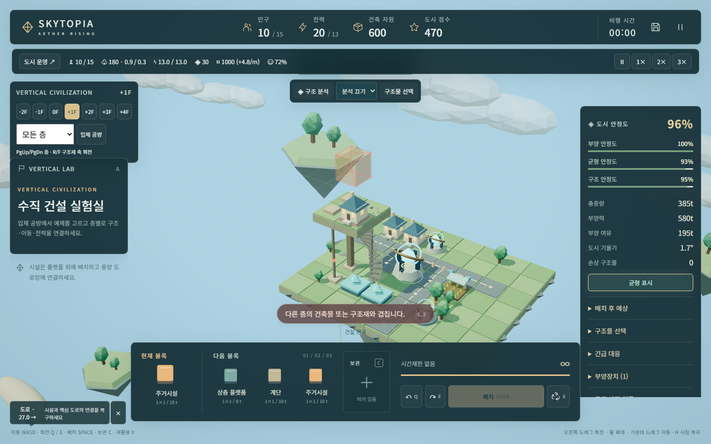
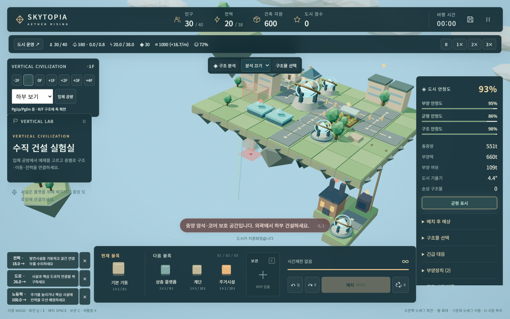

# Phase 5 검증 보고

검증일: 2026-11-26 (Asia/Seoul). Windows, Node.js 24.14.0, AMD Ryzen AI 9 365. [이전 검증](VERIFICATION-PHASE4.md)을 보존했습니다.

## 범위와 결과

브라우저 입력 → Zustand → 순수 TypeScript 배치·구조·도시·캠페인 계산 → Three.js 표시 → 버전별 LocalStorage 검증·복원을 확인합니다. 백엔드/API는 없습니다.

| 항목                     | 결과                           | 범위                                        |
| ------------------------ | ------------------------------ | ------------------------------------------- |
| Vitest 전체              | 178개 통과 / 14파일            | 기존 137개 + 수직 관련 41개                 |
| TypeScript strict / Vite | 통과                           | 프로덕션 빌드, Three.js 청크 권고 경고 유지 |
| Chrome / Edge            | Chrome·Edge 32개 흐름 통과     | 브라우저당 16개 흐름, 수동 성능 4개 생략    |
| CPU 성능                 | 측정 완료                      | 대도시와 4층 252시설 합성 부하              |
| WebGL 성능               | 6개 장면 통과·Canvas 해제 확인 | 실제 GPU가 아닌 SwiftShader                 |

프로덕션 JavaScript에서 **SKYTOPIA_TEST** 및 **SKYTOPIA_PERF** 식별자가 없음을 확인했습니다. 테스트 제어 연결은 개발 서버의 test 모드에서만 노출됩니다. Vitest 전체 테스트가 동기 계산으로 RPC를 지연시키던 문제는 테스트 사이 이벤트 루프 양보로 수정했고 정상 종료 코드 0을 확인했습니다.

Chrome 최초 전체 실행에서 15개가 통과하고, 구조 실험실 재개 버튼의 부분 문자열 선택이 새 수직 실험실 버튼과 겹쳤습니다. 정확한 이름으로 수정한 뒤 해당 파일 3개가 모두 통과했습니다. Edge 전체 16개도 통과했습니다. 마지막 미션의 치명적 위험 금지 조건 추가 후 캠페인 9개를 다시 실행해 통과했으며 최종 테스트 목록은 179개입니다. 프로덕션 빌드도 다시 통과했습니다.

## 명세 A–N

| 항목        | 검증 내용                                        | 방식과 경계                                                    |
| ----------- | ------------------------------------------------ | -------------------------------------------------------------- |
| A 구저장    | Y=0, 인구·건물·진행 유지, v3/v1 원문 보존        | 단위 저장 왕복 및 기존 브라우저 복원                           |
| B 상층 데크 | 기둥 위 데크·상층 주거·계단·전력                 | 단위 + 실제 버튼/Space 건설                                    |
| C 무지지    | 배치 거부·원본 불변                              | 단위                                                           |
| D 체적 충돌 | 2층 주거·다층 블록·천장·아치                     | 단위                                                           |
| E 수직 하중 | 질량 중복 방지·하중 전달·3D 중심                 | 단위                                                           |
| F 보강      | 추가 기둥 분산·보강 비용/강도·임시 지지 만료     | 단위                                                           |
| G 붕괴      | 대체 지지 보존·마지막 지지 소실·중복 제거 방지   | 단위; 모든 복잡한 붕괴 조합 미검증                             |
| H 하부      | 현수 인장·질량/중심·산업/전력                    | 단위 + 예제 D 브라우저                                         |
| I 교량      | 실제 도보/전력/구조 연결·파손 시 단절            | 단위 + 예제 C 브라우저                                         |
| J 승강기    | 정전 중지·대체 계단·복전 회복                    | 단위                                                           |
| K 보기      | 6개 보기·숨김 상태·도시 데이터 유지              | 브라우저; 선택 판정은 표시 규칙 공유, 모든 겹침 조합 미검증    |
| L 카메라    | 6개 시점·층 전환·3D 회전·상층 건설               | 브라우저 + 회전 단위; 기존 회전/기울기 마우스 회귀 포함        |
| M Chapter 4 | 16–20 실제 유료 배치·시간 진행·승리·저장         | 순수 엔진 해법; 전체 사람 플레이/모든 시드/난이도별 3별 미검증 |
| N 기존 회귀 | 공급·건설·구조·경제·인구·행복·캠페인·실험실·저장 | 기존 단위 + 브라우저 전체 흐름                                 |

미션 20은 실제 비용·설치·인구 증가·구조 계산을 거쳐 164.75초에 인구 약 329.29, 안정도 92.57, 순수익 약 5.69를 기록하고 필수 조건을 60초 유지해 승리했습니다. 해법에서 붕괴와 과부하가 없었습니다. 테스트 해법은 허용 블록을 지정하므로 무작위 공급의 모든 시드나 사람의 플레이 시간을 보증하지 않습니다.

## CPU 실측

[원시 측정](performance-vertical.json). 워밍업 3회 후 20회, 중앙값 / p95 (ms). 구조·운영은 파생 캐시를 재사용하지 않는 측정입니다.

| 도시                                          | 구조·운영 재계산 | 0.25초 엔진 진행 | 저장 검증·복원 |
| --------------------------------------------- | ---------------- | ---------------- | -------------- |
| 미션 20 초기: 3층, 187데크, 126시설, 인구 250 | 15.93 / 19.17    | 42.31 / 58.65    | 11.74 / 21.54  |
| 합성 부하: 4층, 256데크, 252시설, 인구 80     | 34.42 / 46.44    | 25.59 / 46.62    | 16.28 / 20.82  |

저장 크기는 각각 46,046 / 75,974바이트입니다. 합성 부하는 시설 수를 늘린 성능 장면이며 자급·장기 구조 안정성을 보장하는 모범 도시가 아닙니다. 렌더링 FPS와 CPU 계산 시간을 혼동하지 않습니다.

## WebGL 실측

[원시 측정](performance-vertical-browser.json). Chrome 158.0.8127.37, 1440×900, DPR 1, 그림자 켬, 개발 빌드, 실제 시뮬레이션 작동. 각 보기에서 약 6초 측정했습니다.

| 장면 / 보기          | 프레임 표본 | 중앙값 / p95 (ms) | 평균 FPS | draw calls |
| -------------------- | ----------- | ----------------- | -------- | ---------- |
| 대도시 / all         | 20          | 284.0 / 445.8     | 3.26     | 545        |
| 대도시 / cutaway     | 22          | 270.7 / 564.5     | 3.40     | 515        |
| 대도시 / structure   | 24          | 228.0 / 584.9     | 4.15     | 212        |
| 4층 합성 / all       | 24          | 233.4 / 488.8     | 3.87     | 581        |
| 4층 합성 / cutaway   | 24          | 237.3 / 466.8     | 3.98     | 500        |
| 4층 합성 / structure | 27          | 230.3 / 468.1     | 4.09     | 558        |

SwiftShader 소프트웨어 렌더링 결과는 평균 3.26–4.15 FPS입니다. 목표 45–60 FPS 달성으로 볼 수 없으며 실제 GPU 성능은 별도 검증이 필요합니다. 각 도시에서 지도로 돌아간 뒤 Canvas가 제거됨을 확인했고 JavaScript 오류는 없었습니다. 이 검사는 장시간 GPU 메모리 누수 보증은 아닙니다.

## 화면과 제한

스크린샷은 설치된 브라우저에서 생성했습니다. 숨김 보기와 구조 모드는 객체를 숨기는 방식이며 임의 메시를 자르는 단면 렌더링이 아닙니다. 개별 화물 용량·승강기 배차·가변 길이 교량·전용 시네마틱은 후속 작업입니다. 상세 구현 및 제한은 [28개 항목 보고](PHASE5-REPORT.md)를 참조하세요.

실제 GPU 45–60 FPS, Firefox/Safari, 모바일, 장시간 메모리 안정성, 모든 난이도와 공급 시드를 검증하지 않았습니다. 공개 배포·DNS·도메인 설정은 변경하지 않았습니다.
