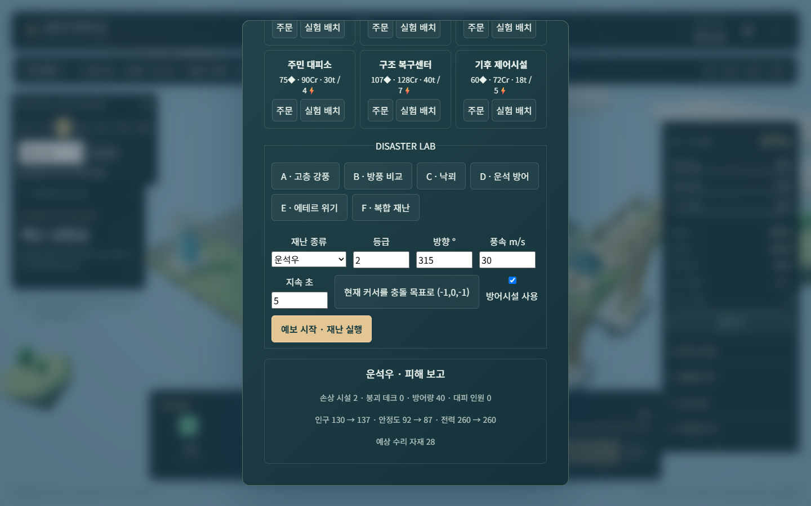
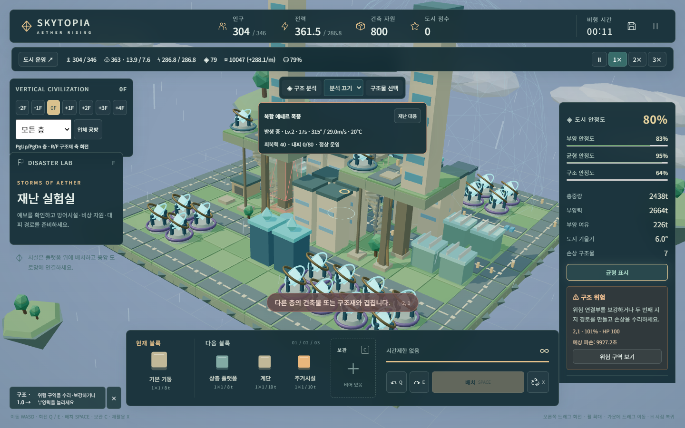

# Phase 6 검증 보고

후속 확인: 커밋 `dec3e4072e35a8bf92e4b4fd931811e41b60898f`의 [GitHub Actions 45837290062](https://github.com/benochansong/skytopia/actions/runs/45837290062)에서 전체 자동 검사·빌드·Chrome 브라우저 검사가 모두 성공했습니다. 아래는 당시 로컬 실행 기록입니다.

검증일: 2026-11-26 (Asia/Seoul). Windows, Node.js 24.14.0, AMD Ryzen AI 9 365. [Phase 5 기록](VERIFICATION-PHASE5.md)을 보존했습니다.

브라우저 입력 → Zustand → 순수 TypeScript 재난·구조·도시·캠페인 → Three.js 표시 → 버전별 LocalStorage 검증·복원을 확인합니다. 백엔드/API는 없습니다.

## 자동 검사

최종 로컬 전체 실행은 18파일 205개 중 201개 통과, 4개 시간 초과였습니다. 긴 도시 시뮬레이션과 소프트웨어 WebGL을 동시에 실행한 부하 때문이며 규칙 단언 실패는 없었습니다. 캠페인 15, 도시 6·9, 수직 20을 단일 작업자로 다시 실행해 모두 통과했습니다(각각 27.69초, 10.85초, 8.79초, 39.42초). 따라서 모든 205개 검사의 통과 근거가 있으나 로컬의 한 번의 전체 실행이 205/205였다고 표시하지 않습니다. 이후 CI 전체 결과를 별도로 기록합니다.

- 초기 전체 검사: 203개 중 196개 통과. 저장 버전 기대값 3개, 부하에 따른 시간 초과 3개, 운석 미션의 소형 방어막 위치 1개를 수정·재검증했습니다.
- 미션 21–25: 유료 배치·보강·재건·실제 시간 진행·승리·저장 5개 통과.
- 최종 저장 경계: 25미션+3도전, 모든 난이도, 이전 도시 장기 동작, 생존 스케줄러 10웨이브 등 별도 7개 통과.
- 타입 검사와 Vite 프로덕션 빌드 통과. Three.js 청크 크기 권고 경고 유지.

## 검사 범위

| 범위        | 근거                                      | 검증 경계                           |
| ----------- | ----------------------------------------- | ----------------------------------- |
| 예보와 재개 | 동일 시드·충돌 계획, 저장 왕복            | 오프라인 진행 없음                  |
| 바람        | 고도·방향·방풍과 실제 토크                | 게임용 근사 하중                    |
| 낙뢰        | 실제 발전 손상·정전·배터리 소모·부양 출력 | 가중 표적 확률의 통계적 검증 아님   |
| 운석·방어막 | 유한 에테르 충전·흡수·초과 피해·중복 ID   | 가장 충전된 방어막 하나 선택        |
| 에테르·중력 | 일시 부양 감소·복구·국소 하중             | 실제 질량 불변                      |
| 기온        | 주거/산업 전력 수요·농업 생산 변화        | 시민 개별 건강 모델 없음            |
| 대피        | 실제 도로 연결·수용량·인구 회계·복귀      | 개별 보행 AI 없음                   |
| 복구        | 실제 자재·크레딧 수리, 설계도 재건        | 드론은 실제 작업의 시각화           |
| 캠페인      | 21–25 실제 승리 경로                      | 모든 난수 공급/난이도 3별 미검증    |
| 생존        | 10종 스케줄·성장 조건·보상·저장           | 10웨이브 장기 도시 완주 검증과 구분 |
| 레거시      | 기존 건설·도시·구조·캠페인·저장           | 새 저장은 구버전 원문 보존          |

## 브라우저

재난 전용 검사에서 예보 저장·복원·충돌·보고, A–F 예제, 8종 분석, 한·영 UI를 확인했습니다. 첫 실행은 분석 선택기의 접근성 이름이 선택 항목 텍스트와 섞여 실패했고, 명시적인 이름을 추가한 뒤 두 흐름 모두 통과했습니다. 전체 회귀에서 프로필 도전 과제 수 24→34에 맞춰 테스트 기대값을 수정했습니다.

Chrome의 기존 18개 흐름은 최초 전체 실행에서 17개 통과·프로필 기대값 1개 실패였고, 수정한 프로필 흐름과 새 생존/자유 건설 흐름을 다시 실행해 2개 통과했습니다. 합계 19개 고유 흐름입니다. Edge 재난 전용 3개 흐름도 모두 통과했습니다. 수동 재난 WebGL 검사 1개(2장면)가 통과했고 각 장면 종료 시 Canvas가 제거됨을 확인했습니다. 테스트 제어 연결은 개발 서버 test 모드에서만 노출됩니다.

## 성능과 제한

CPU 계산과 SwiftShader 소프트웨어 WebGL을 분리 측정합니다. 일반 PC GPU의 45–60FPS 보증은 아닙니다. 효과 24개·충돌 계획 8개·보고 20개·재건 설계도 256개·비 입자 200개 제한이 있습니다. 정지·배속·숨김 탭·저장 재개는 게임 시각을 공유합니다.

초기 중형 도시의 부양기 위치는 실제 해석으로 검증한 고정 좌표를 사용하며 진입 때 매번 최적 배치를 탐색하지 않습니다. 예제 템플릿은 난이도·모드별로 깊은 복제하며 플레이 상태를 공유하지 않습니다.

전체 구현과 30개 보고 항목은 [PHASE6-REPORT.md](PHASE6-REPORT.md)를 참고하세요. 긴 생존 플레이, 모든 공급 시드, 실제 GPU, Firefox/Safari·모바일, 장시간 메모리 안정성은 검증 완료로 보고하지 않습니다.

## CPU 실측

[원시 측정](performance-disaster.json). 다른 검사를 종료한 뒤 워밍업 3회·표본 20회. 중앙값 / p95 (ms).

| 실제 재난 장면     | 구조 재계산   | 0.25초 엔진   | 저장 검증     | 저장 크기 |
| ------------------ | ------------- | ------------- | ------------- | --------- |
| A: 81시설·129데크  | 16.73 / 22.54 | 38.19 / 50.31 | 11.16 / 15.62 | 60,669B   |
| F: 129시설·187데크 | 24.32 / 28.12 | 69.39 / 92.78 | 16.51 / 20.95 | 89,484B   |

## 재난 WebGL 실측

[원시 측정](performance-disaster-browser.json). Chrome 158.0.8127.37, SwiftShader, 1440×900, DPR1, 그림자 켬, 최대 비 입자 200, 개발 빌드, 실제 재난 진행. 약 6.5초 구간 측정입니다.

| 장면        | 표본 | 중앙값 / p95 (ms) | 평균 FPS | draw calls |
| ----------- | ---- | ----------------- | -------- | ---------- |
| 중형 폭풍 A | 9    | 232.7 / 1605.3    | 2.04     | 384        |
| 복합 재난 F | 19   | 347.0 / 1571.6    | 2.40     | 589        |

낮은 소프트웨어 렌더링 FPS와 긴 프레임 지연이 있습니다. **45–60FPS 목표를 검증한 결과가 아닙니다.** 실제 GPU 성능과 장시간 메모리 검사는 남아 있습니다. 표본 수가 작아 p95를 장기 성능 보증으로 해석하지 않습니다.

## 최종 추가 수정

자유 건설의 일반 재난이 생존 웨이브 1의 강풍만 반복하던 스케줄을 수정했습니다. 자유 건설은 저장된 시드로 9종 중 선택하고, 생존은 정해진 10웨이브 순서를 유지합니다. 추가 결정성 검사를 포함해 로컬 검증 대상은 206개입니다.
