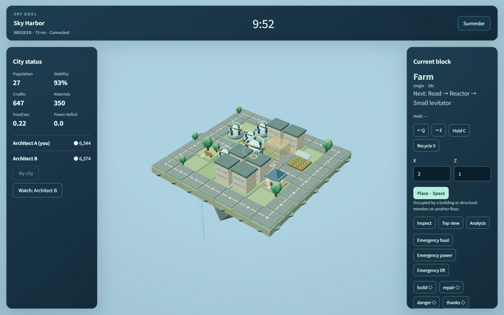
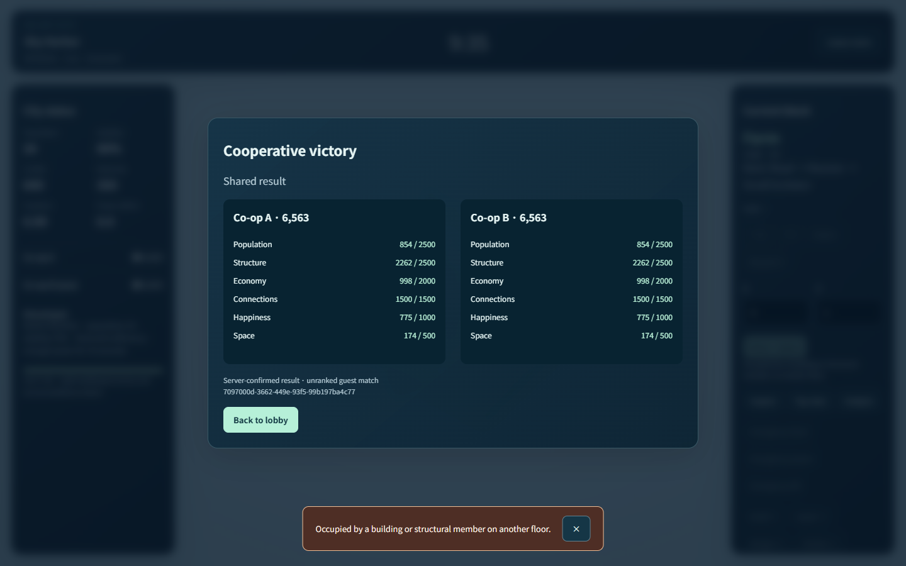

# Phase 8 검증 기록

2026-11-27 · Windows · Node 24.14.0 · v0.8.0. 이전 기록은 `VERIFICATION-PHASE7.md`에 보존했다.

## 자동 검사

| 검사                      | 결과                                                     |
| ------------------------- | -------------------------------------------------------- |
| TypeScript                | `npm run typecheck` 통과                                 |
| 클라이언트 빌드           | 통과, 기존 Three 청크 500kB 권고 경고 유지               |
| 서버 빌드                 | 통과, ESM 291.7kB                                        |
| 온라인 규칙·실제 소켓     | 최종 13개 통과                                           |
| 전체 단위 테스트          | 243개 / 22파일 모두 통과, 550.15초, 처리되지 않은 오류 0 |
| Chrome 전체 흐름          | 23개 통과, 수동 성능 시나리오 6개 skip, 8.5분            |
| Edge 온라인 흐름          | 2개 통과, 1.1분                                          |
| 온라인 서버 부재          | 연결 오류 → 싱글플레이 훈련 복귀 통과                    |
| 실제 프로세스 종료·재시작 | SIGKILL 후 동일 게스트·무효 결과 한 건·승자 없음 확인    |
| 포맷·diff                 | 최종 문서 포함 통과                                      |
| 프로덕션 분리             | dist에 테스트 훅·ADMIN_TOKEN·node:sqlite 없음            |

첫 전체 단위 실행은 241개 중 238개 통과, 기존 긴 캠페인 14·15와 재난 미션 23이 Windows 2워커에서 시간 제한을 초과했다. Windows 기본 워커를 1개로 조정했다. Linux CI는 기존 2개를 유지한다. 최종 실행은 시간 종료와 다중 칸 상한 검사를 더한 총 243개다.

브라우저 초기 진단에서는 메뉴의 `08` 표기와 선택 상자 label을 테스트가 잘못 찾는 문제를 수정했다. 다른 프로젝트가 5175를 점유한 것도 확인했다. 그 프로세스를 중단하지 않고 SKYTOPIA 테스트를 5188로 분리하고 기존 서버 자동 재사용을 껐다. 이후 Chrome 전체와 Edge 온라인이 통과했다. 테스트 DB는 출력 디렉터리 정리와 독립된 `server-data/e2e.sqlite`다.

## 실제 온라인 검증

서로 다른 브라우저 컨텍스트가 실제 WebSocket에 연결한다. 서버 도시·시간·결과를 테스트 훅으로 바꾸지 않고 UI로 명령을 보낸다.

- 대전: 두 게스트 → 비공개 초대 → 양쪽 준비 → 방장 시작 → 카운트다운 → 동일 시작/hand → A 건설 승인 → B의 상대 도시 동기화 → A 새로고침·동일 신원 재접속 → B 포기 확인 → A 승리·전적. 기존 로컬 저장을 실제 만든 상태에서 온라인이 이를 변경하지 않는지 검사했다.
- 협동: 공유 도시 → 같은 위치 동시 건설 → 한 시설·한 hand만 증가 → 상대의 핑 수신 → 정상 블록 세 개 추가 건설 → 서버 시간의 인구 성장과 자급·안정 조건 10초 유지 → 양쪽 공동 승리. Chrome/Edge 모두 통과했다.
- 기존 캠페인·자유 건설·건축 훈련·조작·저장/복원·할당량 오류·구조·수직·재난·문명 탐사/개척/운송·최종 미션을 Chrome에서 검증했다.

서버 13개 테스트는 동일 공급 100개, 보관 시간, 비공개 공급 제거, 엄격한 스키마, 운영 origin, 동일 재난 일정, 다중 칸 건설 상한·거절 시 자원 보존, 시간 종료 무승부, 정상 건설 협동 승리, 실제 매칭, 잘못된 Origin·20KB 프레임 거절, 독립 세션, 소유 도시, 중복 UUID, 다른 경기 명령, 충돌, 방장 철거 권한, 재접속, 관전 변경 금지, 유예 만료, 비공개 방 목록, 준비 조건, 매칭 취소, 모두 끊긴 협동 정지, DB 재시작 결과 불변성을 포함한다.

가상 시간 전진과 경계 fixture는 서버 내부 단위 테스트에만 있다. 네트워크에는 시간·점수·결과 조작 API가 없다. 컴파일된 서버의 실제 강제 종료는 `scripts/online-restart-check.ts`, 서버 없는 실제 Chrome 복귀는 `scripts/online-offline-check.ts`로 별도 검증했다.

## 최종 부하 측정

`npx tsx scripts/online-load.ts`. 빌드 후 순차 실행, 도시당 시설 39개·플랫폼 49개, 실제 소켓으로 각 10초. 서버와 측정 클라이언트가 한 프로세스이므로 CPU/RSS는 합계다. 틱은 서버의 시뮬레이션·전송 콜백 시간이다.

| 대전 / 플레이어 / 도시 | 틱 p50   | 틱 p95   | 전송 합계 | RSS     |
| ---------------------- | -------- | -------- | --------- | ------- |
| 2 / 4 / 4              | 23.13ms  | 59.11ms  | 38.9KB/s  | 134.7MB |
| 4 / 8 / 8              | 41.13ms  | 105.19ms | 78.3KB/s  | 201.8MB |
| 8 / 16 / 16            | 125.49ms | 196.58ms | 163.5KB/s | 286.7MB |

최대 메시지는 약 29.3KB. 4Hz의 250ms 간격에서 위 조건을 실행했다. 최대 도시·재난 다중 활성·명령 폭주·TLS/WAN·장시간 누수 측정이 아니다. 12방 설정이 상용 24명 동접을 보장하지 않는다. 높은 부하에서는 bounded catch-up으로 시뮬레이션 시간이 늦어질 수 있다. 초기 빌드와 함께 돌린 8대전 참고 측정은 p95 178.37ms였으나, 표와 원시 파일은 순차 최종 재측정으로 교체했다.

원시 자료: `verification/phase8-load.json`, `verification/phase8-restart.json`, `verification/phase8-offline.json`.

## 한계와 미검증

- 로컬 loopback과 독립 세션을 검증했다. 공개 인터넷 서버·서로 다른 실제 회선·모바일·Safari/Firefox는 검증하지 않았다. DNS·인증서·운영 도메인을 변경하지 않았다.
- 하드웨어 GPU FPS를 측정하지 않았다. 캡처는 기존 3D 렌더러와 SwiftShader 환경이다. Phase 7 소프트웨어 GPU 제약은 유지된다.
- 정식 계정·복구, 랭킹/시즌, 독립 구조/퍼즐/생존/문명 경쟁, 협동 월드/교역, 리플레이, 자유 채팅/모더레이션, 다중 서버는 미구현이다.
- 서버 재시작은 중간 도시 복원이 아니라 무효 종료다. Node 24 SQLite 실험적 API 경고가 남는다.
- `npm audit`는 기존 Vitest/@vitest-mocker/tinypool 3항목과 Zod 1항목을 보고했다(moderate 1, high 1, critical 2). 테스트 도구를 공개하지 않고 입력을 Zod 전에 16KiB로 제한했으나 의존성 보안 문제의 전체 해결을 주장하지 않는다. 공개 운영 전 호환성을 검증한 업데이트가 필요하다.
- 사람의 장기 밸런스와 모달 포커스 등 접근성 세부 점검은 후속 polish 범위다. 모든 Phase 8 확장 기능 또는 정식 출시 완료를 주장하지 않는다.
